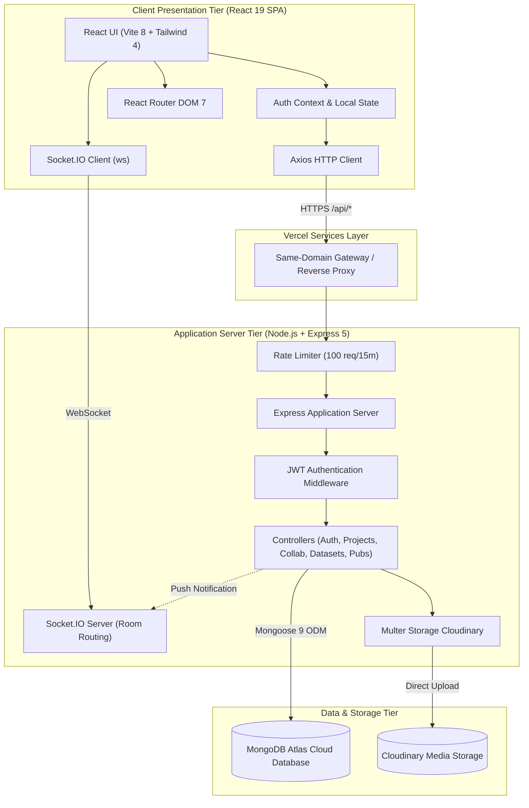
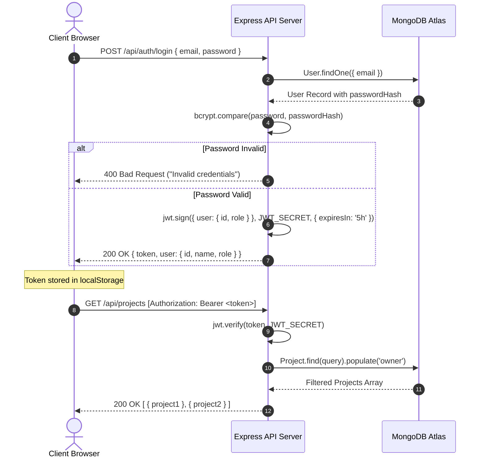
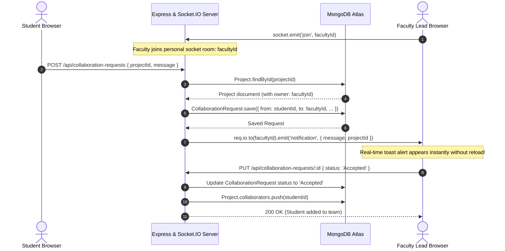
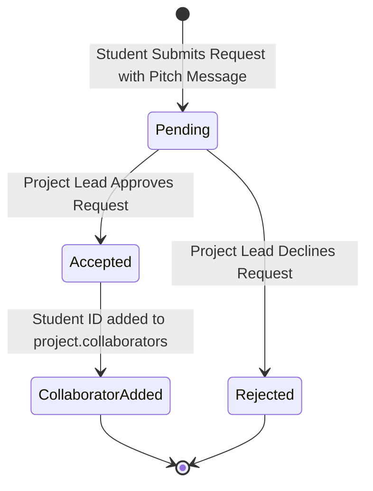
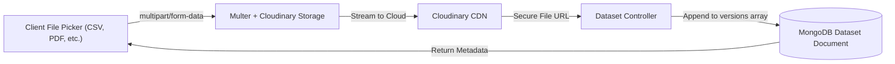
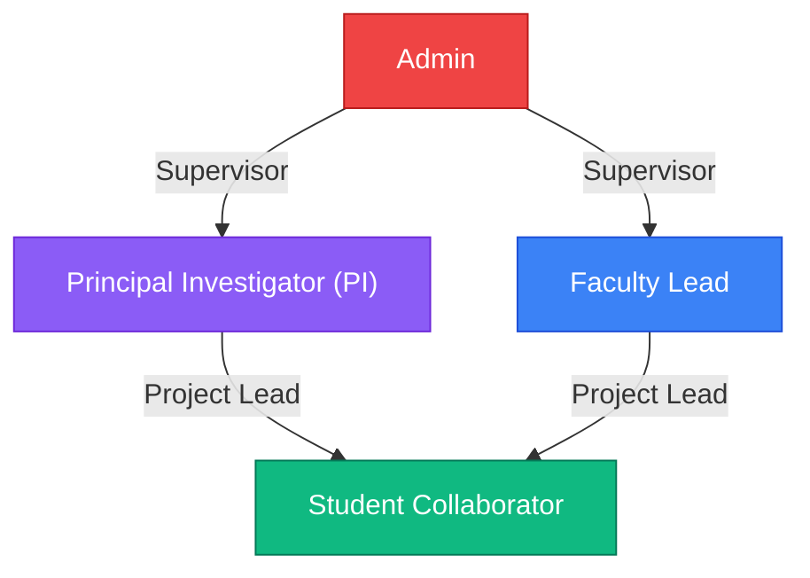

# System Architecture & Technical Specifications

**Project:** ResearchHub (CUSoC T-08)  
**Document:** Architecture Design & Technical Specifications  
**Version:** 1.0  

---

## 1. High-Level Architectural Diagram

ResearchHub follows a modern 3-tier architecture with decoupled presentation and application layers, enhanced with real-time bidirectional WebSocket event channels and cloud-backed file storage:

---

## 2. Authentication & Authorization Sequence

ResearchHub implements stateless authentication using JSON Web Tokens (JWT) with bcrypt-salted password hashing:

---

## 3. Real-Time Collaboration Request Event Flow

When students request to join a project, Socket.IO emits a notification event directly to the personal room of the project lead:

---

## 4. Collaboration Request State Lifecycle

---

## 5. Dataset Versioning & Upload Flow

---

## 6. Role-Based Access Control Hierarchy

