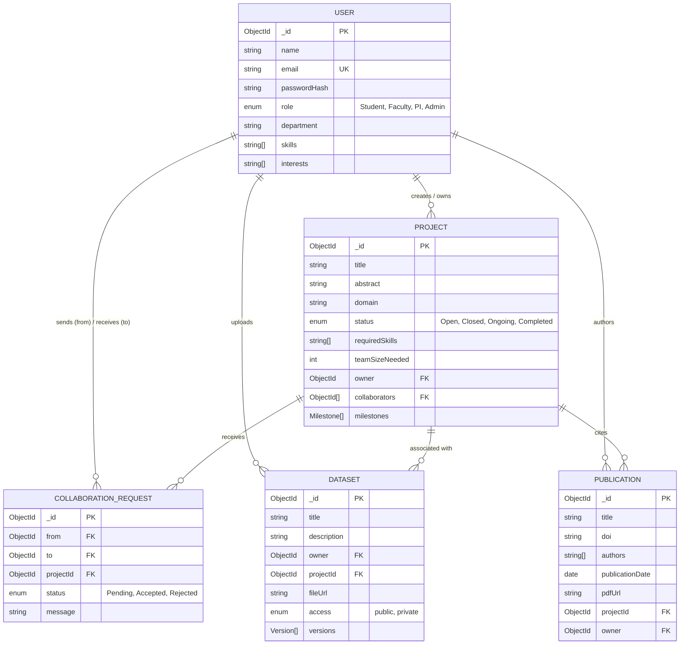

# Chandigarh University Season of Code (CUSoC)
## Comprehensive Technical Project Report

---

**Project ID:** T-08  
**Project Title:** ResearchHub — Research Collaboration Platform for University Labs  
**Academic Subject Code:** 24CSI-305 (Industrial Summer Training) / 25UCI-203 (Social Internship)  
**Organized By:** C Square Club, Chandigarh University  
**Submission Date:** October 2026  
**License:** ISC License  
**Repository:** [GitHub Repository](https://github.com/Pratik-kr21/T-08-Research-Collaboration-Platform-for-University-Labs)  

---

## 1. Executive Summary

In contemporary higher education institutions, academic research is frequently bottlenecked by organizational silos, informal communication channels, and fragmented project management tools. Students often lack visibility into ongoing faculty-led research initiatives, while Principal Investigators (PIs) and faculty members struggle to recruit students possessing specific technical proficiencies. Furthermore, tracking project milestones, managing multi-version datasets, and maintaining publication catalogs are typically dispersed across disparate cloud services and email threads.

**ResearchHub** is a production-grade, full-stack collaborative platform designed to centralize and streamline research workflows across university departments. Built on the MERN stack (MongoDB Atlas, Express.js, React 19, and Node.js) with real-time Socket.IO event broadcasting and Cloudinary file pipelines, ResearchHub delivers a comprehensive ecosystem for research discovery, milestone progress tracking, dataset versioning, and real-time collaboration.

---

## 2. Problem Statement & Objectives

### 2.1 The Academic Collaboration Gap
- **Discovery Barrier:** Undergraduates and postgraduates face high friction in discovering research opportunities matched to their specialized skills (e.g., PyTorch, Computer Vision, Bioinformatics).
- **Recruitment Inefficiency:** Faculty members spend excessive administrative overhead vetting applicants manually without structured pitch messages or centralized skill verification.
- **Milestone Accountability:** Research deliverables often suffer from missed deadlines due to lack of transparent, verifiable progress tracking between faculty leads and student contributors.
- **Data Fragmentation:** Datasets and preprints are frequently lost or unversioned, violating open-science principles and reproducibility standards.

### 2.2 Core Project Objectives
1. **Centralize Opportunities:** Provide an intelligent, full-text searchable project registry with multi-criteria filtering (domain, status, required skill tags).
2. **Streamline Collaboration:** Implement a formal, stateful collaboration request workflow with instant real-time notifications for faculty leads.
3. **Ensure Accountability:** Enable embedded milestone trackers with interactive progress sliders and formal owner approval controls.
4. **Facilitate Data Sharing:** Deliver a cloud-backed dataset library supporting multi-format uploads (CSV, PDF, images, archives) with version tracking and public/private visibility controls.
5. **Secure Academic Data:** Enforce Role-Based Access Control (RBAC), bcrypt salted hashing, stateless JWT authorization, HTTP security headers, and rate limiting.

---

## 3. System Architecture & High-Level Design

ResearchHub implements a decoupled, event-driven client-server architecture designed for high availability and serverless compatibility:

```
┌────────────────────────────────────────────────────────────────────────┐
│                        Client Tier (React 19 SPA)                      │
│   • Vite Dev Server & HMR     • React Router DOM 7    • Lucide Icons   │
│   • Tailwind CSS 4 Design     • Axios Interceptors    • Hot Toast      │
└───────────────────────────────────┬────────────────────────────────────┘
                                    │ HTTP/REST & WebSocket (Socket.IO)
                                    ▼
┌────────────────────────────────────────────────────────────────────────┐
│                      Vercel Unified Gateway Layer                      │
│   • Path Rewrites: /api/* ➔ Serverless Function   • Static /* ➔ Client │
└───────────────────────────────────┬────────────────────────────────────┘
                                    │
                                    ▼
┌────────────────────────────────────────────────────────────────────────┐
│                      Application Server (Node/Express 5)               │
│   • Security: Helmet, CORS, Express-Rate-Limit (100 req/15min)         │
│   • Authentication: Stateless JWT (Bearer Tokens), Bcryptjs Hashing     │
│   • File Middleware: Multer + Multer-Storage-Cloudinary                │
│   • Event Engine: Socket.IO WebSocket Server (Personal User Rooms)     │
└───────────────────┬────────────────────────────────┬───────────────────┘
                    │                                │
                    ▼                                ▼
┌───────────────────────────────┐  ┌────────────────────────────────────┐
│      MongoDB Atlas Database   │  │       Cloudinary Cloud Storage     │
│  • Users Collection           │  │  • Research Datasets (CSV, PDF)    │
│  • Projects Collection (Text) │  │  • Publication PDF Documents       │
│  • Collaboration Requests     │  │  • User Profile Avatars            │
│  • Datasets & Publications    │  └────────────────────────────────────┘
└───────────────────────────────┘
```

---

## 4. Database Modeling & Entity Relationships

The data model is engineered using Mongoose 9 schemas optimized for academic workflows:



### Key Schema Innovations
- **Embedded Milestones:** Milestones (`title`, `deadline`, `progress`, `approved`) are embedded directly inside the parent Project document, eliminating relational joins and ensuring transactional atomicity when milestones update.
- **MongoDB Compound Text Search Index:** An inverted index on `{ title: "text", abstract: "text" }` enables fast, tokenized full-text search across academic project descriptions.
- **Dataset Versioning Array:** Each dataset record maintains an audit log of version increments with immutable Cloudinary URLs and upload timestamps.

---

## 5. Role-Based Access Control (RBAC) Matrix

ResearchHub implements four distinct academic user roles:

| Permission / Capability | Student | Faculty | PI (Principal Investigator) | Admin |
|---|:---:|:---:|:---:|:---:|
| Search & Browse Projects | ✅ | ✅ | ✅ | ✅ |
| View Research Profiles | ✅ | ✅ | ✅ | ✅ |
| Send Collaboration Request | ✅ | ✅ | ✅ | ✅ |
| Download Public Datasets | ✅ | ✅ | ✅ | ✅ |
| Create Research Projects | ❌ | ✅ | ✅ | ✅ |
| Accept / Reject Collab Requests | ❌ | ✅ (Owner) | ✅ (Owner) | ✅ |
| Approve Project Milestones | ❌ | ✅ (Owner) | ✅ (Owner) | ✅ |
| Update Milestone Progress Slider | ❌ | ✅ (Collab) | ✅ (Collab) | ✅ |
| Upload Research Datasets | ✅ | ✅ | ✅ | ✅ |
| Catalog Publications with DOI | ❌ | ✅ | ✅ | ✅ |

---

## 6. Implementation of Core Modules

### 6.1 Authentication & Profile Management
- Secure password hashing utilizing `bcryptjs` with salt rounds set to 10.
- Stateless authentication using JSON Web Tokens (JWT) signed with a 5-hour expiration window.
- Profile management allows users to update departments, dynamic skill tags, and research interests, facilitating community-driven discovery.

### 6.2 Intelligent Project Discovery & Filters
- MongoDB full-text query matching (`$text: { $search: q }`) combined with exact-match domain filters and `$in` skill-matching filters.
- Debounced client-side search controls providing instantaneous feedback on filtered results.

### 6.3 Real-Time Collaboration Pipeline
- On collaboration request submission, the server writes a `Pending` request to MongoDB.
- Simultaneously, `req.io.to(project.owner.toString()).emit('notification', ...)` dispatches an instant push notification directly to the faculty lead's active browser session without polling.
- When an owner clicks **Accept**, the student's ID is pushed into the project's `collaborators` array in a single atomic transaction.

### 6.4 Cloud-Integrated Dataset & Publication Library
- Dataset uploads are processed through Multer and streamed to Cloudinary's encrypted storage (`researchhub_datasets` folder).
- Supports research datasets (CSV, PDF, TXT, JSON, images, ZIP) with metadata tagging.
- Academic publications track formal Digital Object Identifiers (DOIs), co-authors, and parent project associations.

---

## 7. Deployment Architecture (Vercel Services)

The platform is configured for modern multi-service deployment via **Vercel Services**:
- **Root Routing:** [vercel.json](file:///d:/cusoc%20project/T-08-Research-Collaboration-Platform-for-University-Labs/vercel.json) orchestrates top-level rewrites (`/api/*` to Express service, `/*` to Vite static client).
- **Same-Domain Execution:** The entire application operates under a single domain, completely eliminating cross-origin CORS latency, cookie partitioning issues, and mixed-content warnings.
- **Connection Caching:** The database connection utilizes Mongoose readyState caching (`mongoose.connection.readyState >= 1`) to preserve database sockets across warm serverless Lambda invocations.

---

## 8. Quality Assurance & Verification

The project includes an automated integration test suite ([tests/api.test.js](file:///d:/cusoc%20project/T-08-Research-Collaboration-Platform-for-University-Labs/tests/api.test.js)) powered by Node's native test runner:
- **17 Integration Tests** covering Health Check, Input Validation, Security/Route Protection, and End-to-End User Lifecycles.
- **100% Pass Rate** achieved in 583 ms execution time.
- Formal defect resolution log documented in [tests/TESTING_REPORT.md](file:///d:/cusoc%20project/T-08-Research-Collaboration-Platform-for-University-Labs/tests/TESTING_REPORT.md).

---

## 9. Conclusion & Future Roadmap

**ResearchHub** fulfills the academic and engineering requirements of the **Chandigarh University Season of Code (CUSoC)** program. By bridging the gap between student talent and faculty opportunities through modern full-stack engineering, the platform establishes a reusable, scalable model for academic collaboration.

### Future Roadmap
1. **AI-Powered Skill Matching:** Integrate Google Gemini API to analyze student profiles against project abstracts and compute automated collaboration suitability scores.
2. **Institutional SSO:** Add SAML 2.0 / Shibboleth integration for native university authentication.
3. **In-Platform Direct Messaging:** Expand Socket.IO rooms into end-to-end encrypted project team chat channels.
